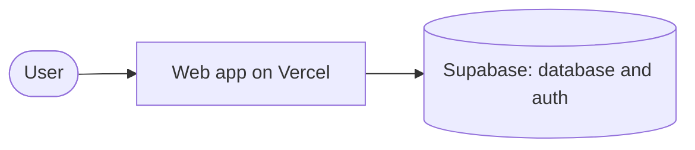
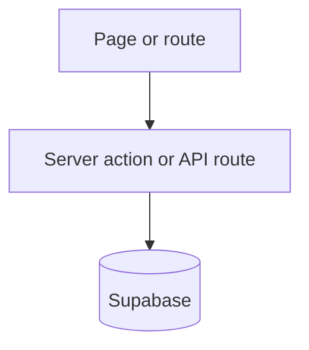
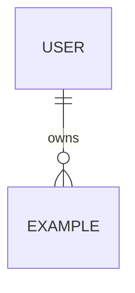
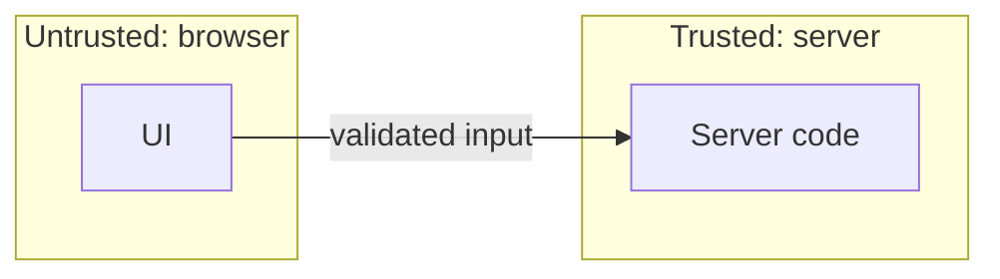

# Architecture

Written by `/plan` before any task is built, approved by the owner with the plan, and kept current by every task that changes a component, a table or an external service. Diagrams are Mermaid, so they render on GitHub and show up in pull request diffs.

Status: not yet written. Replace each placeholder below. Keep every diagram small enough to read at a glance; split it if it grows past about 15 boxes.

## 1. System context

Who and what the product talks to. Include only the services this product uses. The flags in `project.config.yaml` decide whether payments, AI or personal data appear.

## 2. Components and data flow

The main parts of the app and how data moves between them. Name the real folders and routes.

## 3. Data model

Matches "Data model changes" in the specs. One entity per table; note which tables have row level security.

## 4. Trust boundaries

Where data crosses from one level of trust to another: browser to server, server to database, app to third party. Mark where personal data, payments or AI calls cross.

## Decisions that shaped this

Link each ADR in `docs/decisions/` to the part of the diagrams it changes.
